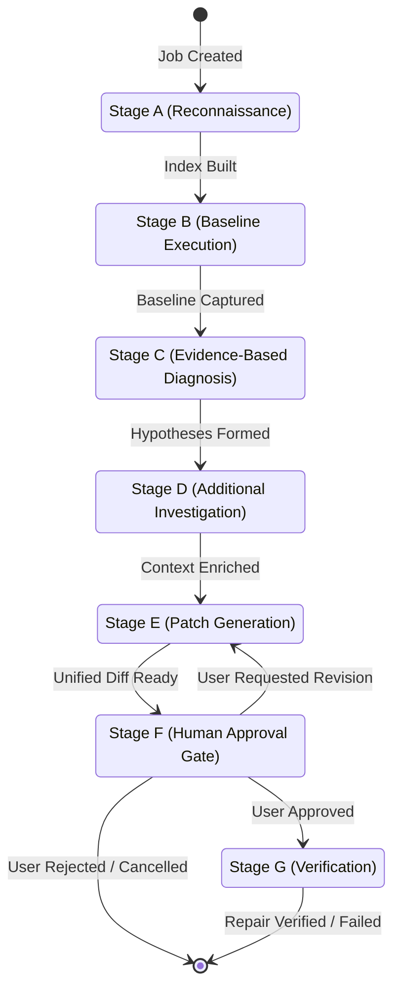

# PatchPilot — Autonomous Debugging Engine (Part 2 Specification)

## 1. Bounded Debugging State Machine

The autonomous engine is implemented in [`app/agents/debugging_agent.py`](../backend/app/agents/debugging_agent.py) as a deterministic state machine that transitions through discrete stages:

### Stage Details

1. **Stage A: Repository Reconnaissance**
   - Indexes files while excluding binary objects, virtual environments (`.venv`, `venv`), build caches, and node modules.
   - Detects languages, entry points, test frameworks (`pytest`, `unittest`), dependency manifests (`requirements.txt`, `pyproject.toml`, `package.json`), and lockfiles (`poetry.lock`, `package-lock.json`, etc.).
   - Discovers potentially sensitive files (`.env*`, `*.pem`, `*.key`, `id_rsa`) and warns or excludes them from model prompts.
   - Audits for dangerous configurations (e.g. symlinks pointing outside the workspace boundary).
   - Generates a compact file index adhering to strict token budgets (`MAX_TOTAL_CONTEXT_BYTES = 24_000`).

2. **Stage B: Baseline Execution**
   - Runs approved test commands inside the isolated Docker sandbox via argument arrays (`["python", "-m", "pytest", "-v", "--tb=short"]`).
   - Captures exact command, exit code, stdout, stderr, execution duration, and timeout status.
   - Employs [`TestRunner.classify_failure`](../backend/app/services/test_runner.py) to differentiate between:
     - Real test assertion failure
     - Missing dependencies (`ModuleNotFoundError`, `ImportError`)
     - Unavailable test runner (`pytest: not found`)
     - Infrastructure/sandbox failure (Docker daemon offline)
     - Execution timeout
   - Fails closed if the sandbox cannot be started rather than fabricating a reproduction.

3. **Stage C: Evidence-Based Diagnosis**
   - Sends user bug description, bounded source excerpts, test outputs, and project metadata to `nvidia/Llama-3.1-Nemotron-70B-Instruct-HF` via Nebius Token Factory.
   - Enforces structured JSON output schema containing:
     - `problem_summary`
     - `hypotheses` with supporting evidence, code locations, and confidence levels
     - `recommended_steps`
     - `relevant_files`
     - `proposed_minimal_repair`
     - `tests_needed_to_verify`
     - `is_confirmed` vs `assumptions`
   - Validates all returned file paths and code locations against the repository root.

4. **Stage D: Additional Investigation (Tool Registry)**
   - Managed by [`ToolRegistry`](../backend/app/agents/tools.py) with approved tools:
     - `list_files`
     - `read_file_excerpt`
     - `search_source`
     - `inspect_manifest`
     - `run_approved_test_command`
     - `get_command_result`
   - No unrestricted shell access.
   - Enforces per-job tool call budgets (`agent_max_tool_calls`, default 20).
   - Path-traversal checks on every tool argument.

5. **Stage E: Patch Generation & Validation**
   - Generates minimal unified diff using low temperature (`temperature=0.05`).
   - [`PatchService.validate_patch`](../backend/app/services/patch_service.py) validates that:
     - All paths stay strictly inside repository root.
     - Protected files (`.env`, `Dockerfile`, `docker-compose.yml`, `.git`) are never touched.
     - Diffs conform to standard unified diff syntax (`@@ -l,s +l,s @@`).
     - Patches do not inject shell execution or dangerous constructs.
     - Diff size and modified file count are bounded.

6. **Stage F: Human Approval Gate**
   - Blocks execution until explicit user decision:
     - `approved`: proceeds to isolated workspace application.
     - `revised`: re-diagnoses and regenerates patch incorporating user feedback notes.
     - `rejected`: halts job without workspace changes.
     - `cancelled`: aborts job and cancels execution task.
   - Original source files are NEVER modified; patches are applied only to isolated workspace copies.

7. **Stage G: Verification**
   - Applies the validated patch to a clean clone in `workspaces/<job_id>_patched`.
   - Runs post-patch test suite in the sandbox.
   - [`VerificationService.compare`](../backend/app/services/verification_service.py) determines:
     - `verified`: all target failing baseline tests pass; zero regressions.
     - `partially_verified`: some failing tests pass; zero regressions.
     - `failed`: no failing tests fixed OR new regressions introduced.
     - `unable_to_verify`: execution error or sandbox limitation.
   - If fix fails, preserves evidence and executes bounded repair iterations (up to `agent_max_repair_iterations`, default 3).
   - Never marks an unverified result as green.

---

## 2. Sandbox Security Architecture

- **Defense in Depth**: Docker is an isolation sandbox, not an infallible security boundary. Untrusted code is NEVER executed directly on the host backend process.
- **Network Isolation**: `--network none` blocks outbound traffic, data exfiltration, and cloud metadata access (`169.254.169.254`).
- **Least Privilege**: Runs as non-root `--user 65534:65534` (nobody:nogroup).
- **Dropped Capabilities**: `--cap-drop ALL` strips all Linux kernel capabilities.
- **Read-Only Root Filesystem**: `--read-only` prevents system tampering; writable tmpfs is mounted at `/tmp:rw,noexec,nosuid,size=64m`.
- **Resource Constraints**: `--cpus`, `--memory 512m`, `--pids-limit 100` (prevents fork bombs), and execution timeouts.
- **Fail-Closed Policy**: If the Docker daemon is unreachable, the execution service returns an explicit error explaining the missing prerequisite.

---

## 3. Demonstration Project

The canonical demonstration project is located in [`demo_projects/python_buggy_app`](../demo_projects/python_buggy_app):
- **Defect**: In `src/calculator.py`, `divide(a, b)` returns `0.0` when `b == 0` instead of raising `ZeroDivisionError("division by zero")`.
- **Reproducing Tests**:
  - `tests/test_calculator.py::test_divide_by_zero` (fails against buggy code).
  - `tests/test_calculator.py::test_divide_by_zero_message` (negative case ensuring fix cannot bypass message check).
- **Regression Suite**: 9 other tests protecting arithmetic operations and average calculations.
- **Reference Fix**: Documented in `known_fix.patch`.

---

## 4. Evaluation Metrics & Observability

Every completed job records structured metrics within `RepairReport.metrics`:
- `bug_reproduced: bool`
- `valid_diagnosis_produced: bool`
- `patch_applied_successfully: bool`
- `original_failing_tests_passed: bool`
- `regression_tests_passed: bool`
- `repair_iterations: int`
- `model_failures: int`
- `sandbox_failures: int`
- `total_duration_seconds: float`

---

## 5. Incomplete Capabilities & Roadmap

The following items are planned for subsequent phases:
1. **JavaScript / TypeScript Sandbox Execution**:
   - Repository analysis currently indexes JS/TS projects. Sandbox execution for `npm test`, `jest`, or `vitest` in Node containers will be added once language-specific sandbox images are built.
2. **Interactive Revision UI (Part 3)**:
   - Backend API fully supports `revised` with `notes`; frontend UI components in Next.js need to render the revision feedback modal.
3. **Multi-File Complex Merge Conflict Resolution**:
   - Pure-Python diff applier uses fuzzy line matching. Highly complex renamings or multi-chunk fuzzy offsets can benefit from deeper 3-way merge capabilities in future iterations.
